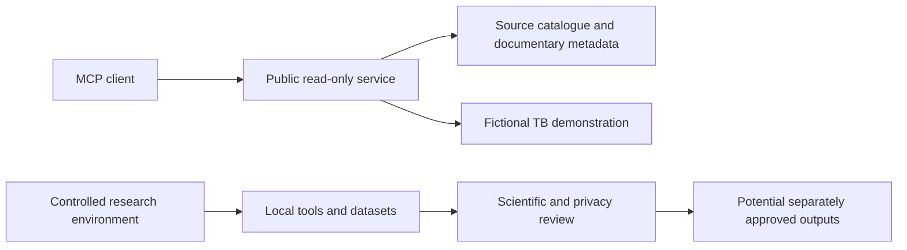

<div align="center">

# SINAN MCP

**Open-source reference discovery and reproducible research workflows for Brazilian notifiable diseases**

[Documentação em português](docs/README.md) · [Guia rápido](docs/QUICKSTART_PUBLICO.md) · [Scientific evidence](docs/instruments-2024/REVIEW_PROTOCOL.md) · [External review](docs/instruments-2024/EXTERNAL_REVIEW.md) · [Security](SECURITY.md)

[](https://github.com/miscrapha-DELTA-IA/SINAN-MCP/actions/workflows/ci.yml) · [MIT License](LICENSE) · Python 3.11+

</div>

> [!IMPORTANT]
> **Independent research prototype.** Not operated, certified or endorsed by Brazil's Ministry of Health, SINAN or DATASUS. The public MCP service returns **fictional demonstration records only**, not official case counts, patient data or validated clinical indicators.

## Overview

**SINAN MCP** uses the Model Context Protocol (MCP) to provide structured access to curated public-health documentary references. It keeps documentary research, fictional software demonstrations and restricted local analysis in separate environments.

| Component | Available today | Boundary |
| --- | --- | --- |
| **Reference catalogue** | 14 internal condition aliases and 17 curated institutional reference pages | A reference link does not establish access to a usable dataset |
| **Zika/TB documentary evidence** | Seven official PDFs with locked SHA-256; 57 matrix records from 3 dictionaries, reused as 42 Zika + 20 TB bundle entries | Historical 57/57 substring checks must be re-run under stricter identifier boundaries; neither semantics nor the 2024 export layout is validated |
| **Public MCP preview** | 10 read-only tools, including 120 deterministic fictional TB demonstration records | No actual SINAN notifications, real indicators, SQLite or external data import |
| **Local research tools** | Experimental ingestion, diagnostics and methodological utilities | Not part of the public service; real-data work requires separate authorization and controls |

## Architecture



The public service has **no path to the private research database**. Passing software tests does not approve epidemiological estimates or the release of personal data.

## Documentary validation

The [Zika and tuberculosis evidence dossier](docs/instruments-2024/REVIEW_PROTOCOL.md) details document identity, apparent versions, byte-integrity checks and page-level field references.

- **Established historically:** 7/7 PDF byte-integrity checks and 57/57 text occurrences under the previous verifier. The tightened identifier test requires a new CI run; occurrence is never semantic validation.
- **Pending:** independent human review of interpretations, 2024 dataset-layout concordance and privacy aspects.
- **Not authorized:** publication of real SINAN counts, individual-level access or medical decisions.

External contributors can use the [review guide](docs/instruments-2024/EXTERNAL_REVIEW.md). Scientific tasks and decisions are tracked in [issue #62](https://github.com/miscrapha-DELTA-IA/SINAN-MCP/issues/62), separate from the presentation documents.

## Public synthetic preview

| Resource | Address |
| --- | --- |
| MCP endpoint (for compatible clients) | [`/mcp`](https://sinan-mcp-public-preview.onrender.com/mcp) |
| Health status | [`/health`](https://sinan-mcp-public-preview.onrender.com/health) |
| About and support | [About](https://sinan-mcp-public-preview.onrender.com/sobre) · [Support](https://sinan-mcp-public-preview.onrender.com/suporte) |
| Policies | [Privacy](https://sinan-mcp-public-preview.onrender.com/privacidade) · [Terms](https://sinan-mcp-public-preview.onrender.com/termos) |

The `/mcp` endpoint is a machine-to-machine protocol, **not a normal web page**. Free hosting may introduce startup delays and does not guarantee continuous availability.

## Local demonstration

Requires Python 3.11+ and Git. The commands below generate **synthetic fixtures only**.

```powershell
git clone https://github.com/miscrapha-DELTA-IA/SINAN-MCP.git
cd SINAN-MCP
py -3.11 -m venv .venv
.\.venv\Scripts\python.exe -m pip install -e ".[dev]"
.\.venv\Scripts\python.exe -m sinan_mcp demo
.\.venv\Scripts\python.exe -m pytest -q
```

See [installation instructions for other platforms](docs/LOCAL_SETUP.md) and the [technical operations index](docs/operations/README.md).

## Documentation and contribution

| Read | Purpose |
| --- | --- |
| [Documentation centre](docs/README.md) | Concise navigation in Portuguese |
| [Public quickstart](docs/QUICKSTART_PUBLICO.md) | Glossary, remote MCP connection and fictional example prompts |
| [Research reference library](docs/research/README.md) | Disease coverage, source provenance and methods |
| [Zika/TB evidence dossier](docs/instruments-2024/REVIEW_PROTOCOL.md) | Primary documents and scientific limitations |
| [Privacy and governance](docs/compliance/README.md) | Data handling and unresolved legal questions |
| [Operating and integration guides](docs/operations/README.md) | Deployment, clients, testing and security |
| [Contributing](CONTRIBUTING.md) | Reproducible reports and synthetic-only contributions |
| [Changelog](CHANGELOG.md) | Versioned software history |

Original source code is distributed under the [MIT License](LICENSE). This does not convey ownership of official documents or government trademarks.
