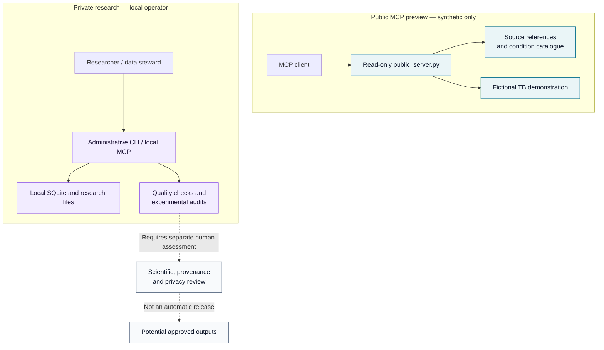

<div align="center">

<h1>SINAN MCP</h1>

<h3>An open research interface for epidemiological data, built around provenance.</h3>

<p><strong>Explore official SINAN references. Prototype with synthetic data. Keep sensitive research workflows separate.</strong></p>

<p>
  <a href="https://github.com/miscrapha-DELTA-IA/SINAN-MCP/actions/workflows/ci.yml"></a>
  <a href="pyproject.toml"></a>
  <a href="LICENSE"></a>
  <a href="#project-status"></a>
  <a href="https://modelcontextprotocol.io/"></a>
</p>

<p><a href="#get-started">Get started</a> · <a href="#architecture">Explore the architecture</a> · <a href="#public-synthetic-preview">Public demo</a> · <a href="#documentation">Documentation</a> · <a href="docs/pt-BR.md">Read in Portuguese</a></p>

</div>

---

> [!IMPORTANT]
> **Research alpha — not an official SINAN/DATASUS product.** The public MCP preview exposes **fictional tuberculosis records**, not live SINAN statistics. Its catalogue links are references, not validated datasets or approved epidemiological indicators. Do not use this project for clinical decisions, official reporting or public-health interventions.

## Why SINAN MCP?

Brazil's *Sistema de Informação de Agravos de Notificação* (SINAN) is a crucial source for public-health research. Working responsibly with surveillance information requires more than downloading a dataset: the source, notification system, data dictionary, reporting year, case definition and disclosure risks all matter.

**SINAN MCP** explores how the **Model Context Protocol (MCP)** can support better-documented workflows around that complexity.

The goal is not to hide scientific uncertainty behind a chatbot. It is to **make uncertainty, provenance and access boundaries explicit** while building reusable open-source tooling for researchers.

| **Discover** | **Prototype** | **Investigate** |
|:---|:---|:---|
| Find curated references to notifiable conditions, official portals and supporting documentation. | Explore a read-only MCP demonstration with deliberately fictional tuberculosis records. | Use separate local tools for imports, diagnostics and experimental methods, subject to human review. |

## What is available

| Capability | Current implementation | Important boundary |
|---|---|---|
| **Source discovery** | Official-source links and a catalogue with **14 internal condition aliases** | Catalogue entries do not prove that a usable dataset exists |
| **MCP interface** | Python-based tools for metadata, descriptions and synthetic examples | Public service never queries the local research database |
| **Synthetic demonstration** | Deterministic fictional TUBE/2024/PI records | Not real notifications, incidence, prevalence or patient counts |
| **Local research toolkit** | Administrative commands for file discovery, ingestion and data diagnostics | Must run in a controlled local environment |
| **Research methods** | Experimental local fairness and aggregate-review utilities | No officially validated predictive model or indicator is provided |
| **Documentation and tests** | Python test suite, CI matrix, security guidance and contribution policy | Passing tests is not a scientific, privacy or security certification |

A disease name appearing in the catalogue does **not** mean all its historical files, dictionaries or indicators are supported. See [catalogue scope](docs/MULTI_AGRAVO_CATALOG.md).

## Architecture

The public demonstration and the private research workflow are intentionally separate.



**The public service has no route to private SQLite files, PySUS ingestion or row-level records.** Its demonstration data are generated by the application itself. Local operations require separate choices and controls. A future real-data publication workflow is **not** enabled merely by importing files or obtaining a test result.

## Get started

Requires **Python 3.11+** and Git. These commands create **synthetic demonstration data**, not an official SINAN dataset.

<details open>
<summary><strong>Windows PowerShell</strong></summary>

```powershell
git clone https://github.com/miscrapha-DELTA-IA/SINAN-MCP.git
cd SINAN-MCP

py -3.11 -m venv .venv
.\.venv\Scripts\python.exe -m pip install -e ".[dev]"
.\.venv\Scripts\python.exe -m sinan_mcp demo
.\.venv\Scripts\python.exe -m pytest -q
```

</details>

<details>
<summary><strong>macOS / Linux</strong></summary>

```bash
git clone https://github.com/miscrapha-DELTA-IA/SINAN-MCP.git
cd SINAN-MCP

python3.11 -m venv .venv
.venv/bin/python -m pip install -e ".[dev]"
.venv/bin/python -m sinan_mcp demo
.venv/bin/python -m pytest -q
```

</details>

### Run a local MCP demonstration

After creating the synthetic database:

```bash
python -m sinan_mcp --db ./data/sinan-demo.sqlite3 servir
```

This command starts the **local stdio MCP server**. Configure your chosen MCP client to launch it with the appropriate absolute Python and database paths. Do **not** expose the local server on a public network. See the [Windows ChatGPT connector guide](docs/CHATGPT_TUNNEL_WINDOWS.md) and [security policy](SECURITY.md).

## Public synthetic preview

| Resource | Endpoint |
|---|---|
| **MCP Streamable HTTP** | [sinan-mcp-public-preview.onrender.com/mcp](https://sinan-mcp-public-preview.onrender.com/mcp) |
| **Service health check** | [sinan-mcp-public-preview.onrender.com/health](https://sinan-mcp-public-preview.onrender.com/health) |
| **Public-service rules** | [Launch and privacy disclosure](docs/PUBLIC_DISCLOSURE.md) |

The preview is hosted separately, with **synthetic records only**, and may take time to respond after inactivity on free hosting. Endpoint availability can change; a link is not an uptime guarantee.

**Examples of public MCP tools**

```text
pesquisar_agravos("tuberculose", limite=5)
descrever_agravo("TUBE")
listar_fontes_oficiais()
listar_agravos()
```

The public demonstration also includes narrow numeric examples for a **fictional** TUBE/2024/PI dataset. Any returned counts must be interpreted solely as software demonstration output, never as evidence about real populations.

## Project status

This is a **research prototype**, not a completed epidemiological data service.

| Workstream | Current status |
|---|---|
| Public reference catalogue and synthetic MCP demo | **Implemented** |
| Local import, diagnostics and experimental analysis | **Prototype** |
| Real-data metrics approved for public release | **None** |
| Independent epidemiological and privacy validation | **Required** |
| General-purpose disease coverage | **Not established** |
| Clinical or government use | **Out of scope** |

**Active research track: Zika dictionary curation.** A candidate transcription of **37 fields from an eight-page public PDF** and **seven documented ambiguities** is under review in [PRs #25–#28](https://github.com/miscrapha-DELTA-IA/SINAN-MCP/pull/28). Those changes are **draft work, not part of the default branch**, and they do **not** validate the ZIKA/2024 annual data export. Independent documentary review remains pending.

Read the [epidemiological interpretation guide](docs/EPIDEMIOLOGY.md) before using any aggregate or exploratory measure in research.

## Security and research ethics

The project is designed to distinguish **reference discovery**, **local scientific work** and **potential publication**.

- **No patient records in GitHub or CI.** Tests use synthetic fixtures.
- **No real clinical dataset in the public preview.** No public row-level interface or arbitrary SQL.
- **Private datasets remain the operator's responsibility.** Local projections may contain quasi-identifiers; a reduced set of fields is not proof of anonymization.
- **Small-cell suppression is not a privacy guarantee.** Linkage and differencing risks require independent assessment.
- **No automatic endorsement.** Importing a file, checking a hash or reviewing a dictionary does not certify an epidemiological result.

Security concerns should be reported privately to maintainers, without including sensitive health information. See [SECURITY.md](SECURITY.md).

## Documentation

| Start here | What you will find |
|---|---|
| [Complete Portuguese README](docs/pt-BR.md) | Full project overview in Portuguese |
| [Condition catalogue](docs/MULTI_AGRAVO_CATALOG.md) | Scope, sources and internal aliases |
| [Epidemiological interpretation](docs/EPIDEMIOLOGY.md) | Definitions, denominators and limitations |
| [Public preview and disclosure](docs/PUBLIC_DISCLOSURE.md) | Synthetic-data boundary and service notice |
| [Technical E2E and deployment baseline](docs/TECHNICAL_CONSOLIDATION_E2E.md) | Public MCP contract, tests and verified Render revision |
| [Local research and release safeguards](docs/AGGREGATE_PUBLICATION.md) | Candidate aggregates and independent review requirements |
| [Predictive fairness protocol](docs/FAIRNESS_PROTOCOL.md) | Exploratory offline assessment and limitations |
| [Security policy](SECURITY.md) | Data handling, threat boundaries and deployment precautions |
| [Contributing](CONTRIBUTING.md) | How to propose changes with reproducible evidence |
| [Historical technical notes](docs/TECHNICAL_README_ARCHIVE.md) | Archived detailed implementation context; not current validation status |

## Roadmap

- [x] Public, isolated, synthetic-only MCP demonstration
- [x] Source-reference catalogue for multiple notifiable conditions
- [x] Local administrative tooling and automated tests
- [ ] Independently reviewed, year-specific data dictionaries
- [ ] Reproducible source and release provenance across supported conditions
- [ ] Independently assessed privacy and epidemiological publication gates
- [ ] Research-grade evaluation of reliability, usability and limitations

These are **research milestones**, not delivery commitments or claims that real epidemiological services will be released.

## Contributing

Contributions are especially welcome in documentation, reproducible tests, epidemiological semantics, dictionary curation, data provenance, privacy engineering and MCP interoperability.

1. Read [CONTRIBUTING.md](CONTRIBUTING.md) and [SECURITY.md](SECURITY.md).
2. Start with an issue describing the use case, source or reproducible problem.
3. Submit focused changes using **synthetic fixtures only**; document scientific assumptions and limitations.

If the project is useful for your work, **star the repository**, share it with collaborators and help improve its scientific rigor. Stars support discovery; they are not evidence of scientific validity.

## License and attribution

Original project code is licensed under the [MIT License](LICENSE). Optional third-party dependencies may carry separate licensing obligations.

**Independent open-source research project. Not affiliated with, endorsed by or operated by Brazil's Ministry of Health, DATASUS or SINAN.**

<div align="center">
  <sub>Built for reproducibility, transparency and responsible epidemiological research.</sub>
</div>

### Public preview security operations

A separate draft security-hardening effort defines per-process admission controls, cross-platform dependency checks, incident procedures and pre-deployment gates. It does **not** deploy any code or enable real SINAN data. Read [operational safeguards](docs/SECURITY_OPERATIONS.md), [branch protection](docs/BRANCH_PROTECTION.md) and [Render verification checklist](docs/RENDER_SECURITY_VERIFICATION.md).
