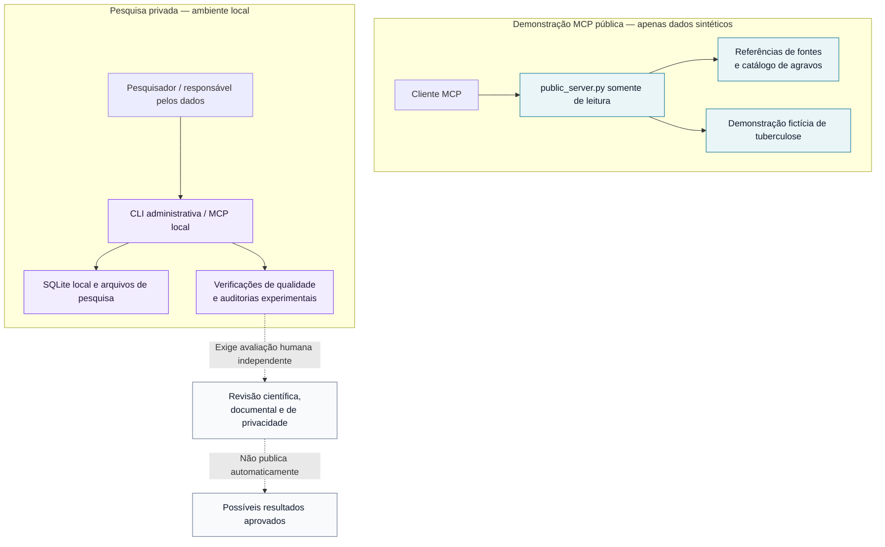

<div align="center">

<h1>SINAN MCP</h1>

<h3>Uma interface aberta para pesquisa epidemiológica, construída com foco em proveniência.</h3>

<p><strong>Explore referências oficiais do SINAN. Experimente com dados sintéticos. Mantenha os ambientes de pesquisa sensíveis separados.</strong></p>

<p>
  <a href="https://github.com/miscrapha-DELTA-IA/SINAN-MCP/actions/workflows/ci.yml"></a>
  <a href="../pyproject.toml"></a>
  <a href="../LICENSE"></a>
  <a href="#estado-do-projeto"></a>
  <a href="https://modelcontextprotocol.io/"></a>
</p>

<p><a href="#comece-aqui">Comece aqui</a> · <a href="#arquitetura">Arquitetura</a> · <a href="#demonstração-pública-sintética">Demonstração pública</a> · <a href="#documentação">Documentação</a> · <a href="../README.md">Versão em inglês</a></p>

</div>

---

> [!IMPORTANT]
> **Versão alfa de pesquisa — não é um produto oficial do SINAN/DATASUS.** A demonstração pública do MCP usa **registros fictícios de tuberculose**, não estatísticas atualizadas do SINAN. Os links do catálogo são referências documentais; não representam bases validadas nem indicadores epidemiológicos homologados. Não utilize este projeto para decisões clínicas, relatórios oficiais ou intervenções em saúde pública.

## Por que o SINAN MCP?

O *Sistema de Informação de Agravos de Notificação* (SINAN) é uma fonte importante para a pesquisa em saúde pública no Brasil. O uso responsável de informações de vigilância exige mais do que obter um arquivo: é necessário compreender a origem dos dados, o sistema de notificação, o dicionário de variáveis, o ano de referência, as definições de caso e os riscos de divulgação.

O **SINAN MCP** investiga como o **Model Context Protocol (MCP)** pode apoiar fluxos de pesquisa melhor documentados diante dessa complexidade.

A proposta não é esconder as incertezas científicas atrás de um assistente de IA, mas **tornar explícitas a incerteza, a proveniência e as restrições de acesso**, enquanto se desenvolve uma infraestrutura aberta e reutilizável.

| **Descubra** | **Experimente** | **Investigue** |
|:---|:---|:---|
| Localize referências sobre agravos de notificação, portais oficiais e documentação técnica. | Utilize uma demonstração MCP somente de leitura com registros fictícios de tuberculose. | Use ferramentas locais separadas para importação, diagnóstico e métodos experimentais, sujeitos à revisão humana. |

## O que está disponível

| Capacidade | Implementação atual | Limite importante |
|---|---|---|
| **Descoberta de fontes** | Links oficiais e catálogo com **14 identificadores internos de agravos** | Um item no catálogo não comprova a existência de base utilizável |
| **Interface MCP** | Ferramentas em Python para metadados, descrições e exemplos sintéticos | O serviço público nunca consulta o banco local de pesquisa |
| **Demonstração sintética** | Registros fictícios e determinísticos de TUBE/2024/PI | Não representam notificações, incidência, prevalência ou pacientes reais |
| **Ferramentas locais** | Comandos administrativos de descoberta, importação e diagnóstico | Devem ser executados em ambiente local controlado |
| **Métodos de pesquisa** | Utilitários experimentais de equidade algorítmica e revisão de agregados | Nenhum modelo preditivo ou indicador oficial foi validado |
| **Documentação e testes** | Suíte de testes Python, integração contínua, segurança e contribuições | Testes aprovados não equivalem a certificação científica, de privacidade ou segurança |

A presença de um agravo no catálogo **não** significa que todos os seus arquivos históricos, dicionários ou indicadores sejam compatíveis. Consulte o [escopo do catálogo](MULTI_AGRAVO_CATALOG.md).

## Arquitetura

A demonstração pública e o ambiente privado de pesquisa são intencionalmente separados.



**O serviço público não possui caminho de acesso aos arquivos SQLite privados, à importação pelo PySUS ou a registros individuais.** Os dados de demonstração são gerados pelo próprio aplicativo. Operações locais exigem escolhas e controles separados. Uma futura publicação com dados reais **não** se torna autorizada apenas porque um arquivo foi importado ou passou em testes.

## Comece aqui

É necessário ter **Python 3.11 ou superior** e Git. Estes comandos criam **dados fictícios de demonstração**, não uma base oficial do SINAN.

<details open>
<summary><strong>Windows PowerShell</strong></summary>

```powershell
git clone https://github.com/miscrapha-DELTA-IA/SINAN-MCP.git
cd SINAN-MCP

py -3.11 -m venv .venv
.\.venv\Scripts\python.exe -m pip install -e ".[dev]"
.\.venv\Scripts\python.exe -m sinan_mcp demo
.\.venv\Scripts\python.exe -m pytest -q
```

</details>

<details>
<summary><strong>macOS / Linux</strong></summary>

```bash
git clone https://github.com/miscrapha-DELTA-IA/SINAN-MCP.git
cd SINAN-MCP

python3.11 -m venv .venv
.venv/bin/python -m pip install -e ".[dev]"
.venv/bin/python -m sinan_mcp demo
.venv/bin/python -m pytest -q
```

</details>

### Execute uma demonstração MCP local

Após criar a base sintética:

```bash
python -m sinan_mcp --db ./data/sinan-demo.sqlite3 servir
```

Esse comando inicia o **servidor MCP local via entrada e saída padrão (stdio)**. Configure o cliente MCP escolhido para executar o comando usando caminhos absolutos para o Python e o banco de dados. **Não** exponha o servidor local à internet. Consulte o [guia do conector ChatGPT para Windows](CHATGPT_TUNNEL_WINDOWS.md) e a [política de segurança](../SECURITY.md).

Os identificadores de comandos e ferramentas permanecem em português por compatibilidade com a interface já implementada. Eles não são textos de apresentação traduzíveis.

## Demonstração pública sintética

| Recurso | Endereço |
|---|---|
| **MCP via HTTP com transmissão** | [sinan-mcp-public-preview.onrender.com/mcp](https://sinan-mcp-public-preview.onrender.com/mcp) |
| **Verificação de funcionamento** | [sinan-mcp-public-preview.onrender.com/health](https://sinan-mcp-public-preview.onrender.com/health) |
| **Regras de divulgação** | [Aviso de demonstração e privacidade](PUBLIC_DISCLOSURE.md) |

A demonstração é hospedada separadamente, **somente com dados sintéticos**, e pode demorar a responder após períodos de inatividade na hospedagem gratuita. A disponibilidade do endereço pode mudar; um link publicado não garante funcionamento contínuo.

**Exemplos de ferramentas MCP públicas**

```text
pesquisar_agravos("tuberculose", limite=5)
descrever_agravo("TUBE")
listar_fontes_oficiais()
listar_agravos()
```

A demonstração também oferece exemplos numéricos restritos a uma base **fictícia** de TUBE/2024/PI. Qualquer contagem retornada deve ser interpretada exclusivamente como exemplo do funcionamento do software, nunca como evidência sobre populações reais.

## Estado do projeto

Este projeto é um **protótipo de pesquisa**, não um serviço epidemiológico concluído.

| Frente de trabalho | Estado atual |
|---|---|
| Catálogo público de referências e demonstração MCP sintética | **Implementados** |
| Importação, diagnósticos e análises experimentais locais | **Protótipo** |
| Indicadores reais aprovados para divulgação pública | **Nenhum** |
| Validação epidemiológica e de privacidade independente | **Necessária** |
| Cobertura genérica de qualquer doença | **Não estabelecida** |
| Uso clínico ou governamental | **Fora do escopo** |

**Pesquisa em andamento: curadoria do dicionário de Zika.** Uma transcrição candidata de **37 campos de um PDF público de oito páginas** e **sete ressalvas documentais** está em revisão nos [PRs #25–#28](https://github.com/miscrapha-DELTA-IA/SINAN-MCP/pull/28). Essas alterações permanecem **em rascunho, fora da branch principal**, e **não** validam a distribuição anual ZIKA/2024. A segunda revisão documental independente está pendente.

Antes de interpretar qualquer agregado ou medida exploratória em pesquisa, consulte o [guia de interpretação epidemiológica](EPIDEMIOLOGY.md).

## Segurança e ética em pesquisa

O projeto diferencia **descoberta de referências**, **trabalho científico local** e **eventual publicação**.

- **Sem dados de pacientes no GitHub ou na integração contínua.** Os testes usam exemplos sintéticos.
- **Sem bases clínicas reais na demonstração pública.** Não há interface pública de registros individuais nem SQL arbitrário.
- **Bases privadas são responsabilidade de seu operador.** Projeções locais podem conter quase-identificadores; reduzir campos não comprova anonimização.
- **Suprimir células pequenas não garante privacidade.** Riscos de vinculação e reidentificação por diferenças entre consultas exigem avaliação independente.
- **Sem aprovação automática.** Importar um arquivo, conferir um hash ou revisar um dicionário não certifica um resultado epidemiológico.

Vulnerabilidades devem ser comunicadas privadamente aos mantenedores, sem incluir informações sensíveis de saúde. Consulte a [política de segurança](../SECURITY.md).

## Documentação

| Comece por aqui | Conteúdo |
|---|---|
| [Versão completa em inglês](../README.md) | Apresentação completa em inglês |
| [Catálogo de agravos](MULTI_AGRAVO_CATALOG.md) | Escopo, fontes e identificadores internos |
| [Interpretação epidemiológica](EPIDEMIOLOGY.md) | Definições, denominadores e limitações |
| [Demonstração pública e privacidade](PUBLIC_DISCLOSURE.md) | Limites dos dados sintéticos e aviso do serviço |
| [Pesquisa local e divulgação responsável](AGGREGATE_PUBLICATION.md) | Agregados candidatos e requisitos de revisão independente |
| [Protocolo de equidade preditiva](FAIRNESS_PROTOCOL.md) | Auditoria exploratória local e limitações |
| [Política de segurança](../SECURITY.md) | Tratamento de dados e segurança operacional |
| [Como contribuir](../CONTRIBUTING.md) | Como propor alterações com evidências reprodutíveis |
| [Notas técnicas históricas](TECHNICAL_README_ARCHIVE.md) | Histórico de implementação; não comprova validações atuais |

## Próximas etapas

- [x] Demonstração MCP pública, isolada e exclusivamente sintética
- [x] Catálogo de referências para múltiplos agravos de notificação
- [x] Ferramentas administrativas locais e testes automatizados
- [ ] Dicionários específicos por ano com revisão independente
- [ ] Proveniência de fontes e versões reprodutível entre os agravos compatíveis
- [ ] Critérios de divulgação epidemiológica e de privacidade avaliados independentemente
- [ ] Avaliação científica de confiabilidade, usabilidade e limitações

São **marcos de pesquisa**, não promessas de entrega nem indicação de que haverá divulgação de dados reais.

## Como contribuir

Contribuições são bem-vindas em documentação, testes reprodutíveis, semântica epidemiológica, curadoria de dicionários, proveniência, engenharia de privacidade e interoperabilidade MCP.

1. Leia [CONTRIBUTING.md](../CONTRIBUTING.md) e [SECURITY.md](../SECURITY.md).
2. Abra uma solicitação (issue) descrevendo o caso de uso, a fonte ou um problema reproduzível.
3. Envie alterações específicas usando **apenas exemplos sintéticos**, documentando pressupostos e limitações científicas.

Se o projeto for útil, **marque o repositório com uma estrela**, compartilhe com colaboradores e ajude a melhorar seu rigor científico. Estrelas favorecem a descoberta do projeto, mas não demonstram validade científica.

## Licença e atribuição

O código original do projeto está sob a [Licença MIT](../LICENSE). Dependências opcionais de terceiros podem ter obrigações de licenciamento próprias.

**Projeto independente de pesquisa em código aberto. Não afiliado, endossado nem operado pelo Ministério da Saúde, DATASUS ou SINAN.**

<div align="center">
  <sub>Desenvolvido com foco em reprodutibilidade, transparência e responsabilidade na pesquisa epidemiológica.</sub>
</div>
